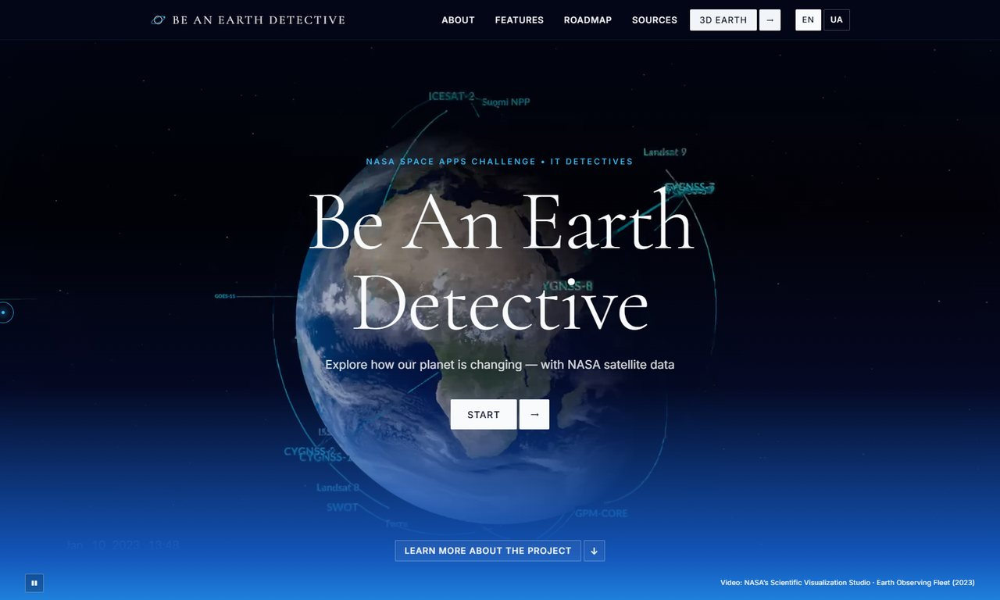
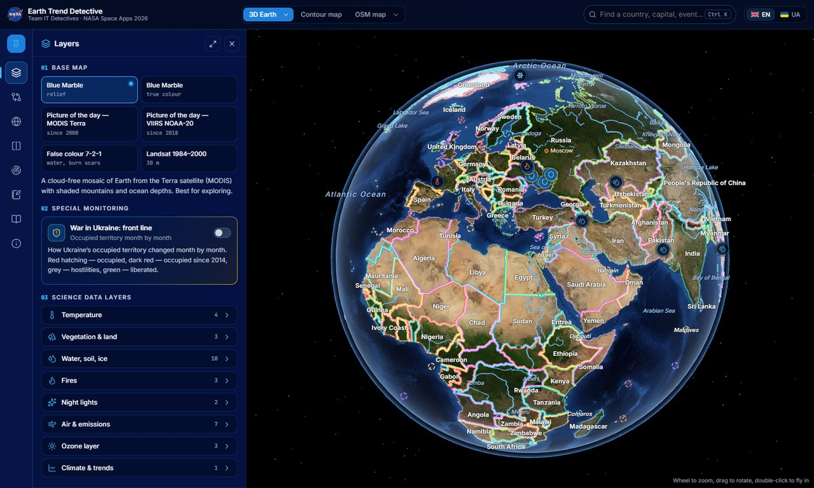
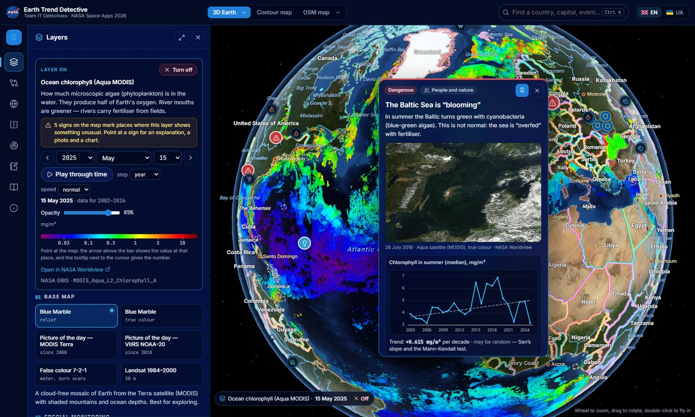
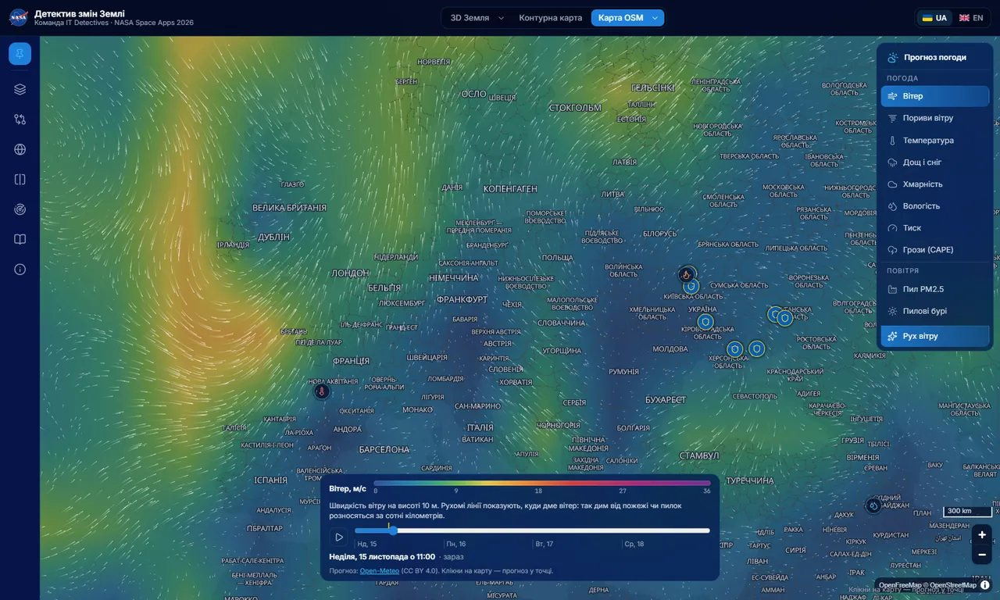
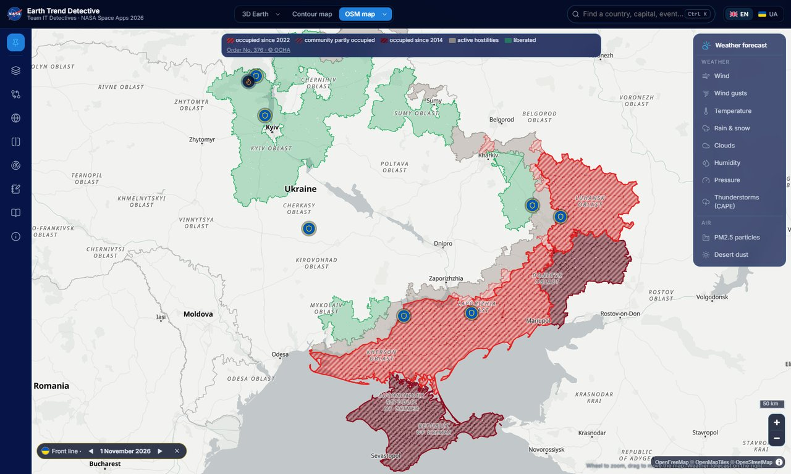
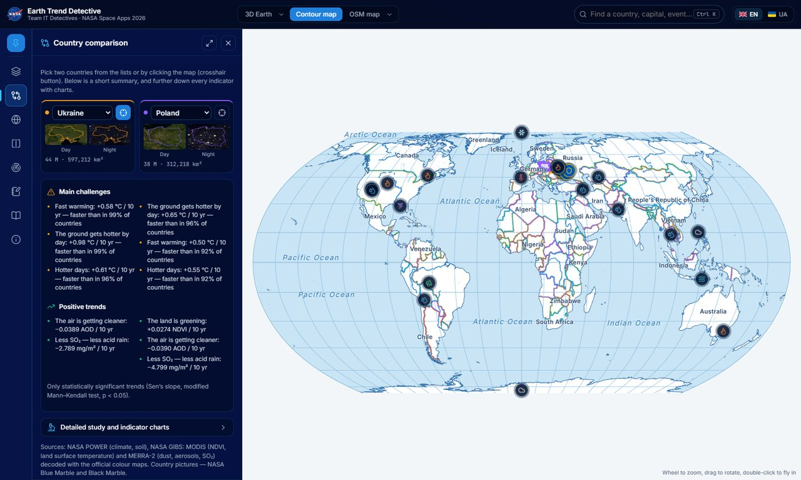
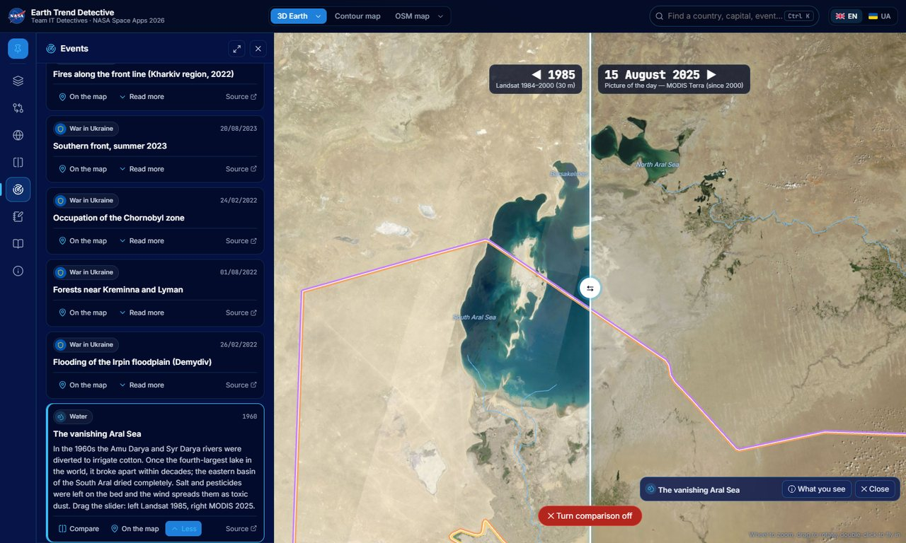
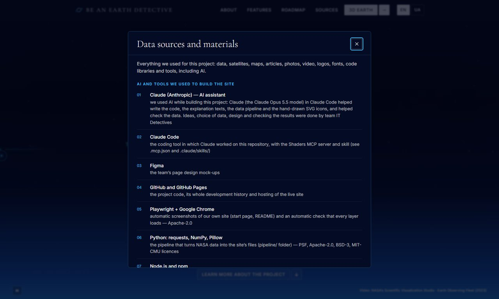

# Earth Trend Detective — IT Detectives

**English** · [Українська](README.uk.md)


**NASA Space Apps Challenge 2026 · [Earth System Trend Detective](https://www.spaceappschallenge.org/2026/challenges/earth-system-trend-detective/)**

### ▶ Live site: **https://luufus.github.io/Nasa-Space-App-Challenge/**

An interactive Earth for anyone curious about how our planet is changing. Pick a topic — temperature,
forests, fires, ice or air pollution — and the site shows real NASA satellite data, checks whether a change
is really a trend and explains the result in plain words. English and Ukrainian, free, no sign-up.

- **The problem.** Everyone talks about the climate, but checking it yourself is hard: NASA data sits on dozens
  of websites in unusual formats and units, and one hot year is not a trend yet — without statistics it is easy
  to believe both panic and denial.
- **Our solution.** Everything in one place: a 3D Earth, a contour map and an OpenStreetMap map with a weather
  forecast. The app computes the trend itself (Sen’s slope and the Mann–Kendall test), shows how far you can
  trust it and explains the formulas with everyday examples.
- **Who it is for.** Students (lessons, science fairs, olympiads), teachers, journalists, researchers and the
  simply curious. No special knowledge needed.

## Screenshots

| | |
|---|---|
|  **Start page** — what the project is, NASA video and photos |  **3D Earth** — 39 NASA layers with dates, legend and value under the cursor |
|  **Anomaly hints** — signs on the map open a card: what is wrong, why, photo and trend chart |  **OSM map + weather** — moving wind lines and a 4-day forecast (Open-Meteo) |
|  **War in Ukraine** — occupied territories by month from the official list |  **Country comparison** — trends, statistics and plain-language explanations |
|  **Before / after** — the Aral Sea, Kakhovka and other places with a slider |  **Sources** — every data source, picture, tool and library we used |

## Features

| | |
|---|---|
| 🌍 **3D Earth** | NASA GIBS tiles with levels of detail (like Google Earth), atmosphere, stars and real clouds of the chosen day (VIIRS) |
| 🛰 **OSM map** | A detailed OpenStreetMap map (MapLibre GL), flat or as a globe: classic, light, dark (OpenFreeMap vector tiles, labels in English or Ukrainian) or NASA satellite with labels. The same NASA GIBS layers in web Mercator with the value under the cursor, the front line, events, fires and country comparison |
| ⚠️ **Anomaly hints** | When a layer is on (chlorophyll, NDVI, temperature, ice, fires, NO₂, aerosols, SO₂, ozone, GRACE, rain, night lights…), signs appear where it shows something unusual — 26 places. Point at a sign to open a card you can scroll: what you see, why (people or nature), what it threatens, a real example, what is being done, a satellite photo of the place and a chart of the change over the years with a trend (Sen + Mann–Kendall) |
| 🌙 **Earth at night** | The whole planet in city lights (Black Marble 2016) — a button in the “Night lights” layers and a link from the photo on the start page |
| 🌬 **Weather forecast** (inspired by Windy) | A live 4-day Open-Meteo forecast on the OSM map: moving wind lines, gusts, temperature, rain, clouds, humidity, pressure with isobars, thunderstorms (CAPE), PM2.5 and dust storms (CAMS); a time bar with animation, a legend and a point forecast with a chart and the place name (Nominatim) |
| 🗺 **Contour map** | The globe “unfolds” into a world map (Equal Earth projection) with white land, blue seas and a grid — like a school contour map |
| 🧭 **Borders and labels** | Every country is outlined in its own colour on the inside of the border, so you can see whose border it is; Crimea is part of Ukraine (Natural Earth, Ukraine POV). Countries, capitals, rivers, oceans and seas without overlaps |
| 🛰 **Layers** | 39 NASA layers: air and surface temperature, NDVI/EVI, soil moisture, rain, humidity, snow, ice, GRACE, fires, night lights, NO₂, PM2.5, aerosols, SO₂, CO, methane, ozone… with separate year / month / day pickers, a patient time player, a legend and the value under the cursor |
| 📈 **Country comparison** | Two countries, 15 variables, seasons, anomalies, the A−B difference. Trend = **Sen’s slope** with a 95 % interval + **modified Mann–Kendall test** (Hamed & Rao 1998, autocorrelation correction) + **seasonal Mann–Kendall test** (Hirsch 1982); Z, the critical value 1.96 and p are shown; least squares for comparison. A forecast to 2030–2050 along Sen’s line with a 95 % interval and a hindcast check. Formulas with the real numbers and “why exactly these numbers” |
| 🌡 **Trend maps** | Our own per-pixel calculations (Sen’s slope + modified Mann–Kendall): where the trend is significant (p < 0.05); first vs last decade with a slider; yearly temperature anomalies 1980–2025 with animation |
| ⇆ **Before / after** | A split screen with a slider: the Aral Sea (Landsat 1985 → MODIS 2025), Kakhovka, Lake Urmia, Lake Poopó, Rondônia, Pakistan floods… |
| 🇺🇦 **War in Ukraine** | The front line and occupied territories month by month since February 2022 from the **official list** (Order No. 376 of the Ministry for Development of Communities and Territories) on OCHA community boundaries, with animation and date comparison; occupied area chart; events: Kakhovka dam, blackouts (night lights), fires along the front, the Chornobyl zone, forests near Kreminna, Demydiv; FIRMS fire chart 2001–2025 by region |
| 🔥 **Fire spread** | NASA FIRMS fire points day by day (colour = age of the fire), playback, daily histogram, movement of the fire centre (Chornobyl zone 2020, Australia 2019–20, Canada 2023, the front 2022–23) |
| 🌀 **2026 events** | US wildfires, a European heatwave, a hurricane, Lake Powell, floods in Thailand, an earthquake and tsunami — before/after and “causes” charts: how the weather before the event differed from the 1991–2020 normal (NASA POWER) |
| 🔎 **Search, notes, roadmap** | Search for a country, capital or event (Ctrl+K); personal notes with links to layers, dates and places (kept only in your browser, export/import as a file); a “Coming next” list with an AI assistant and other plans |
| 📖 **Glossary** | ~50 terms and formulas (NDVI, p-value, Mann–Kendall, Dobson unit…) |
| 🇬🇧/🇺🇦 | English by default, Ukrainian one click away |

## Run it on your computer

```bash
npm install
npm run dev        # http://localhost:5173
npm test           # unit tests for the statistics
npm run build      # static site in dist/ (works from any sub-folder)
npm run preview    # look at the built site
```

## Publish to GitHub Pages

```bash
npm run deploy     # builds dist/ and pushes it to the gh-pages branch
```

The site then opens at `https://<user>.github.io/<repository>/`. All asset paths are relative and the app uses
`#/…` addresses, so no server setup is needed. In the repository settings, **Settings → Pages → Build and
deployment** must be set to *Deploy from a branch*, branch `gh-pages`, folder `/ (root)`.

## Rebuild the data

The data is already in `public/data`. To rebuild it from NASA and the other original sources:

```bash
python -m pip install -r pipeline/requirements.txt
python pipeline/run_all.py            # all steps (the first run downloads a few GB of tiles, ~30 min)
python pipeline/run_all.py 02 06      # only some steps
```

Step 10 (front line) reads the official list of occupied territories: download the annexes to Order No. 376
(.docx, currently three files of the 26 May 2026 edition) from
[zakon.rada.gov.ua/laws/show/z0380-25](https://zakon.rada.gov.ua/laws/show/z0380-25) into `pipeline/data/tot/` and run
`python pipeline/run_all.py 10`. A community counts as occupied when at least half of its listed settlements are occupied.

For developers with Claude Code: `.mcp.json` connects the [Shaders](https://shaders.com/docs/guide/mcp) MCP server
(it asks you to sign in to Shaders the first time), and `.claude/skills/shaders/` holds the library’s skill.

## Stack

React 19 · Vite · Three.js (our own tile engine, no ready-made globe library) · MapLibre GL (OSM map) · Shaders
(WebGPU effects on the start page) · ECharts · KaTeX · Zustand · Lucide · Python (requests, NumPy, Pillow) for
converting NASA data.

```
src/engine/    3D engine: TileLayer (GIBS quadtree), LineLayer (borders), Labels, Controls, globe↔map morph
src/lib/       statistics (stats.js + tests), explanations, legends (colour → number), dates, saved views
src/ui/        panels: layers, compare, country report, planet, before/after, events, fires, causes, glossary, notes, about
src/map/       OpenStreetMap view (MapLibre): base maps, NASA layers in web Mercator, front line, weather (Open-Meteo)
src/landing/   start page (content.js = all texts; shaders.jsx = WebGPU effects)
src/content/   events, anomaly hints, glossary, variables, sources (English / Ukrainian texts)
pipeline/      01…11 Python scripts that turn NASA (and other open) data into files in public/data
scripts/       deploy to GitHub Pages; copy the list of sources into the READMEs
```

## Use of AI

We used AI while building this project: **Claude (Anthropic)**, the Claude Opus 5.5 model in Claude Code, helped
write the code, the explanation texts, the data pipeline and the hand-drawn SVG icons, and helped check the data.
Ideas, choice of data, design and checking the results were done by team IT Detectives.

## Honest limitations

- A country value is the average of several NASA POWER points inside it (1 for small countries up to 16 for the
  largest), not every kilometre.
- Trend maps and country NDVI were obtained by turning GIBS image colours back into numbers using the official colour
  map: precision is limited by the palette step (e.g. ~0.5 °C).
- The forecast extends a linear trend; it is not a climate model.
- This is a student hackathon project, not an official NASA product, and it is not endorsed by NASA.

## Sources and credits

Everything we used: data, satellites, maps, articles, photos, video, logos, fonts, code libraries and tools.
The same list is on the site (start page → **Sources**, and the **About** panel in the app). It is copied here from
[`src/content/sources.js`](src/content/sources.js) with `npm run sources`.

<!-- sources:start -->

### AI and tools we used to build the site

- [Claude (Anthropic) — AI assistant](https://www.anthropic.com/claude) — we used AI while building this project: Claude (the Claude Opus 5.5 model) in Claude Code helped write the code, the explanation texts, the data pipeline and the hand-drawn SVG icons, and helped check the data. Ideas, choice of data, design and checking the results were done by team IT Detectives
- [Claude Code](https://claude.com/claude-code) — the coding tool in which Claude worked on this repository, with the Shaders MCP server and skill (see .mcp.json and .claude/skills/)
- [Figma](https://www.figma.com) — the team’s page design mock-ups
- [GitHub and GitHub Pages](https://github.com/LuuFus/Nasa-Space-App-Challenge) — the project code, its whole development history and hosting of the live site
- [Playwright + Google Chrome](https://playwright.dev) — automatic screenshots of our own site (start page, README) and an automatic check that every layer loads — Apache-2.0
- [Python: requests, NumPy, Pillow](https://www.python.org) — the pipeline that turns NASA data into the site’s files (pipeline/ folder) — PSF, Apache-2.0, BSD-3, MIT-CMU licences
- [Node.js and npm](https://nodejs.org) — building the site and unit tests for the statistics (node --test) — MIT

### NASA data and services

- [NASA GIBS (WMTS / WMS)](https://gibs.earthdata.nasa.gov) — all satellite imagery and data layers, official colour maps and legends; part of NASA EOSDIS / Earthdata — public domain (NASA)
- [NASA Worldview](https://worldview.earthdata.nasa.gov) — the “Open in NASA Worldview” link of every layer
- [NASA Worldview Snapshots](https://wvs.earthdata.nasa.gov) — satellite photos of the places in the anomaly hints (Terra, Aqua, Suomi NPP) — public domain
- [NASA POWER](https://power.larc.nasa.gov) — climate of 246 countries 1981–2025, the hotspot charts and daily weather for the 2026 events (NASA Langley Research Center POWER Project) — free use
- [NASA GISS GISTEMP v4](https://data.giss.nasa.gov/gistemp/) — planet temperature since 1880 (GISTEMP Team: GISS Surface Temperature Analysis, NASA Goddard Institute for Space Studies)
- [datasets/global-temp](https://github.com/datasets/global-temp) — a CSV copy of the same GISTEMP numbers, used by the pipeline only when the NASA server cannot be reached — ODC-PDDL
- [NASA Ozone Watch](https://ozonewatch.gsfc.nasa.gov) — ozone hole area and minimum ozone
- [NASA FIRMS](https://firms.modaps.eosdis.nasa.gov) — fires in Ukraine 2001–2025 and fire spread during events. We acknowledge the use of data from NASA’s Fire Information for Resource Management System (FIRMS), part of NASA’s ESDIS
- [NASA DSCOVR EPIC](https://epic.gsfc.nasa.gov) — photo of the whole Earth from 1.5 million km (21 June 2025) — public domain

### Satellites, instruments and models behind the layers (all served by NASA GIBS)

- [Terra & Aqua — MODIS (NASA)](https://www.earthdata.nasa.gov/data/instruments/modis) — pictures of the day, false colour 7-2-1, land surface temperature, NDVI / EVI, snow, land cover (MCD12Q1), ocean chlorophyll, fires
- [Suomi NPP, NOAA-20, NOAA-21 — VIIRS (NASA / NOAA)](https://www.earthdata.nasa.gov/data/instruments/viirs) — pictures of the day, fires (375 m), daily night-time radiance, ocean chlorophyll
- [Black Marble (NASA)](https://blackmarble.gsfc.nasa.gov) — night lights of the whole planet (VIIRS)
- [Blue Marble (NASA Earth Observatory)](https://science.nasa.gov/earth/earth-observatory/collections/blue-marble/) — base pictures of the Earth (relief and true colour)
- [Landsat (NASA / USGS) — WELD](https://science.nasa.gov/mission/landsat/) — Landsat 1984–2000 mosaic (Web-Enabled Landsat Data) and “before” pictures
- [MERRA-2 (NASA GMAO)](https://gmao.gsfc.nasa.gov/gmao-products/merra-2/) — monthly air temperature, root-zone soil water, precipitation, water vapour, dust PM2.5, aerosols, SO₂, ozone at 50 hPa
- [GHRSST MUR (NASA JPL PO.DAAC)](https://podaac.jpl.nasa.gov/MEaSUREs-MUR) — sea surface temperature and its anomaly
- [SMAP (NASA)](https://smap.jpl.nasa.gov) — daily root-zone soil moisture
- [GPM IMERG (NASA / JAXA)](https://gpm.nasa.gov/data/imerg) — daily precipitation
- [AIRS on Aqua (NASA JPL)](https://airs.jpl.nasa.gov) — air humidity and methane
- [AMSR2 on GCOM-W (JAXA)](https://www.eorc.jaxa.jp/AMSR/) — sea-ice concentration (AMSR Unified product)
- [GRACE & GRACE-FO (NASA / DLR / GFZ)](https://grace.jpl.nasa.gov) — water storage (GRACE Tellus mascons) and the groundwater hint for India
- [Aura — OMI (NASA, KNMI, FMI)](https://science.nasa.gov/mission/aura/) — nitrogen dioxide (NO₂) and total ozone
- [Suomi NPP — OMPS (NASA / NOAA)](https://ozoneaq.gsfc.nasa.gov) — total ozone
- [Terra — MOPITT (Canadian Space Agency, University of Toronto, NCAR)](https://www2.acom.ucar.edu/mopitt) — carbon monoxide (CO)
- [Sentinel-5P — TROPOMI (ESA / EU Copernicus, KNMI)](https://sentiwiki.copernicus.eu/web/s5p-mission) — nitrogen dioxide (NO₂, TROPOMI layer). Contains modified Copernicus Sentinel data, processed by ESA and KNMI

### Other science data

- [NOAA GML — Mauna Loa CO₂](https://gml.noaa.gov/ccgg/trends/) — atmospheric CO₂ (Dr. Xin Lan, NOAA/GML, and Dr. Ralph Keeling, Scripps) — US government, public domain
- [NSIDC Sea Ice Index v4 (G02135)](https://nsidc.org/data/g02135) — sea-ice extent (Fetterer et al., National Snow and Ice Data Center) — free with citation
- [Open-Meteo](https://open-meteo.com) — weather data by Open-Meteo.com: the forecast on the “OSM map” (best-match models of national weather services such as DWD, NOAA, ECMWF) — CC BY 4.0, non-commercial use
- [Copernicus Atmosphere Monitoring Service (CAMS)](https://atmosphere.copernicus.eu) — air-quality forecast (PM2.5, dust) through Open-Meteo: generated using Copernicus Atmosphere Monitoring Service information
- [NOAA NESDIS](https://www.nesdis.noaa.gov/imagery/hurricanes/2026-hurricane-season-media-gallery) — Hurricane Isaias 2026 (link)

### Maps, borders and place names

- [OpenStreetMap](https://www.openstreetmap.org/copyright) — world map of the “OSM map” — © OpenStreetMap contributors, ODbL
- [Nominatim](https://nominatim.org) — place names for the point forecast (reverse geocoding on nominatim.openstreetmap.org) — © OpenStreetMap contributors, ODbL
- [OpenFreeMap](https://openfreemap.org) — OpenStreetMap vector tiles and Noto Sans map fonts (light and dark maps) — free, no key
- [OpenMapTiles](https://openmaptiles.org) — vector tile schema and the Positron / Dark Matter styles behind the light and dark maps — © OpenMapTiles, style design © CARTO; BSD-3 / CC BY 4.0
- [Natural Earth 1:10m (Ukraine POV)](https://www.naturalearthdata.com) — borders, capitals, rivers, lakes, seas (files from github.com/nvkelso/natural-earth-vector) — public domain
- [OCHA COD-AB Ukraine (HDX)](https://data.humdata.org/dataset/cod-ab-ukr) — Ukrainian community boundaries for the front layer — CC BY-IGO (with attribution)
- [Order No. 376 of the Ministry for Development of Communities and Territories of Ukraine](https://zakon.rada.gov.ua/laws/show/z0380-25) — the official list of occupied territories and combat areas — an official document (not subject to copyright)
- [Equal Earth projection (Šavrič, Patterson, Jenny, 2019)](https://doi.org/10.1080/13658816.2018.1504949) — the map projection of the contour map — free to use

### Articles, facts and methods (links only, the texts are written by us)

- [NASA Earth Observatory / NASA Science](https://science.nasa.gov/earth/earth-observatory/) — articles behind the events and anomaly hints
- [NASA Climate](https://science.nasa.gov/climate-change/) — the Arctic sea-ice record story
- [NOAA and NOAA GLERL](https://www.glerl.noaa.gov) — Gulf of Mexico “dead zone” and Lake Erie algal blooms
- [HELCOM](https://helcom.fi) — Baltic Sea algal blooms and dead zones
- [IAEA](https://www.iaea.org/newscenter/focus/ukraine) — facts for the war events (nuclear sites in Ukraine)
- [EcoZagroza (Ministry of Environmental Protection of Ukraine)](https://ecozagroza.gov.ua) — war damage to nature
- [Wikipedia](https://en.wikipedia.org) — dates and figures for some 2026 events
- [Trend statistics](https://doi.org/10.1016/S0022-1694(97)00125-X) — Sen’s slope (Sen, 1968), Mann–Kendall test (Mann, 1945; Kendall, 1975), modified Mann–Kendall test (Hamed & Rao, 1998), seasonal Mann–Kendall test (Hirsch et al., 1982) — our own code
- [Windy.com](https://www.windy.com) — inspiration for the weather map (moving wind lines, time bar) — no code or data taken

### Photos, video, icons, fonts and logos

- [NASA Scientific Visualization Studio](https://svs.gsfc.nasa.gov/5061/) — start-page background video “Earth Observing Fleet (January 2023)” — NASA satellites in orbit; the original 1920×1080 60 fps file, a 1280×720 copy and its poster frame; public domain
- [NASA Image and Video Library](https://images.nasa.gov) — photos “Earthrise” (Apollo 8, 1968), “The Blue Marble” (Apollo 17, 1972), “Black Marble” (Suomi NPP, 2016) — public domain
- **Screenshots of this site** — the pictures of the features on the start page and in README are screenshots of our own site
- [Lucide icons](https://lucide.dev) — interface and event-marker icons — ISC; the start-page icons were drawn for this project (SVG code)
- [Fonts: Cormorant Garamond, Inter, JetBrains Mono (Fontsource), Noto Sans](https://fontsource.org) — SIL Open Font License 1.1
- [NASA Space Apps Challenge logo](https://www.spaceappschallenge.org) — shown to name the hackathon; belongs to NASA Space Apps
- [Noosphere Engineering School logo](https://noosphereglobal.com/) — logo of our partner, supplied by the team; belongs to its owner
- [NASA logo](https://www.nasa.gov/nasa-brand-center/) — belongs to NASA; shown only as a reference to the hackathon. This is a student project, not endorsed by NASA

### Open-source code libraries

- [React 19](https://react.dev) — the user interface — MIT
- [Vite 8 and @vitejs/plugin-react](https://vite.dev) — development server and build — MIT
- [Three.js](https://threejs.org) — the 3D globe (our own tile engine on top of it) — MIT
- [MapLibre GL JS](https://maplibre.org) — the “OSM map” (flat and globe) — BSD-3-Clause
- [Apache ECharts](https://echarts.apache.org) — charts — Apache-2.0
- [KaTeX](https://katex.org) — formulas — MIT
- [Zustand](https://github.com/pmndrs/zustand) — app state — MIT
- [Lucide / lucide-react](https://lucide.dev) — icon components — ISC
- [Shaders](https://shaders.com) — WebGPU effects of the start page (ripples under the cursor, aurora) — MIT

### The challenge

- [NASA Space Apps Challenge 2026 — “Earth System Trend Detective”](https://www.spaceappschallenge.org/2026/challenges/earth-system-trend-detective/) — the challenge this project answers; built by team IT Detectives
<!-- sources:end -->

## Team

IT Detectives · NASA Space Apps Challenge 2026
