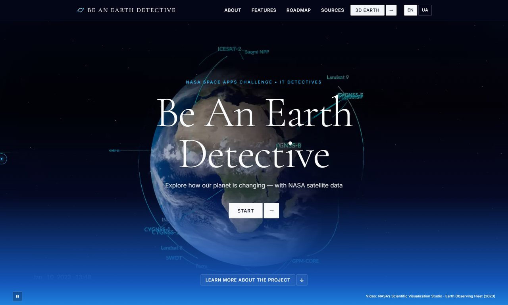
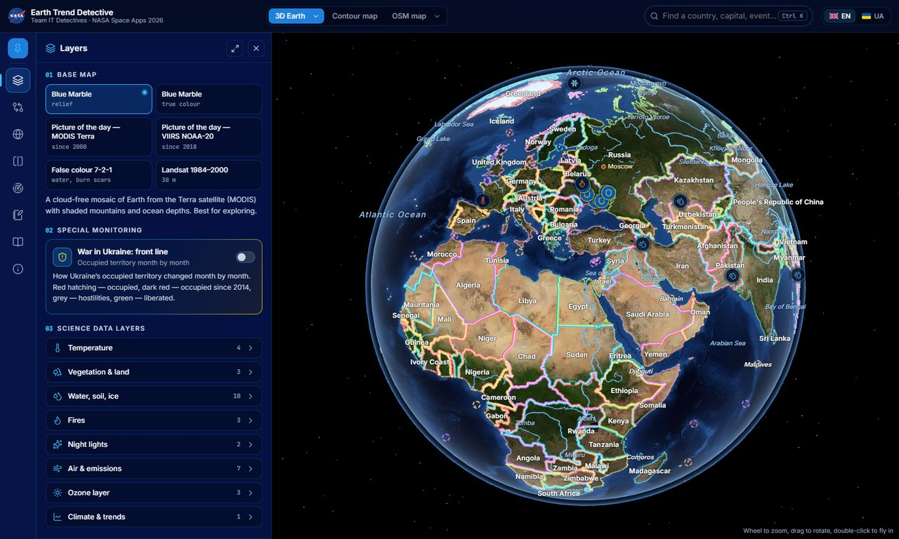
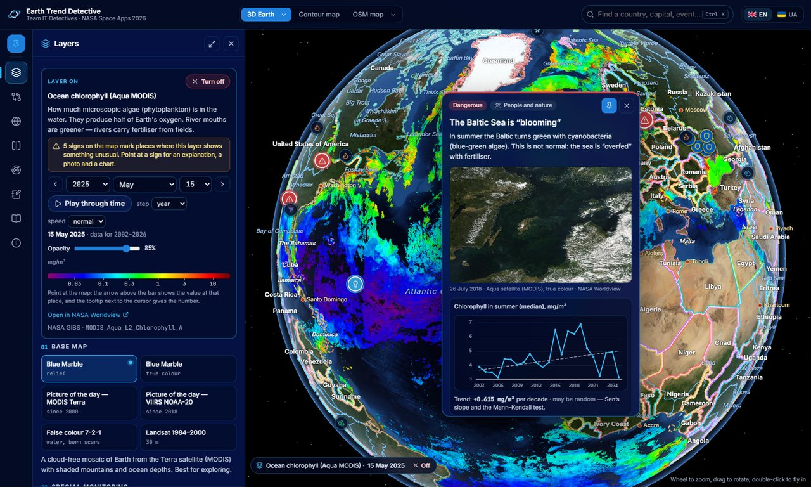
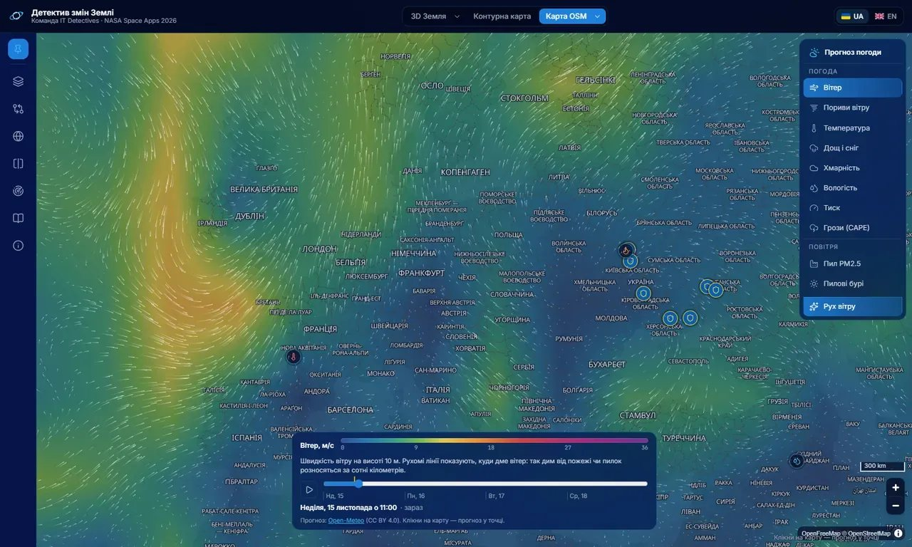
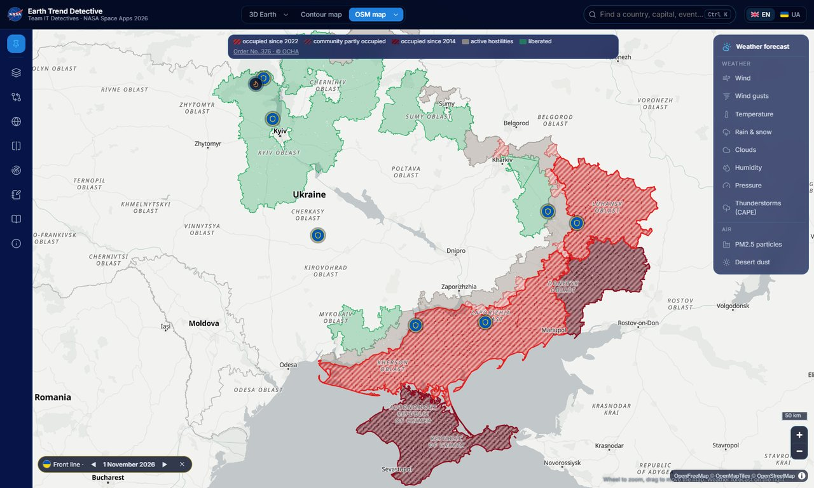
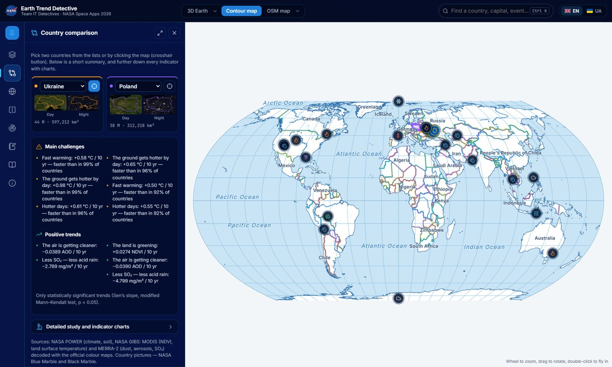
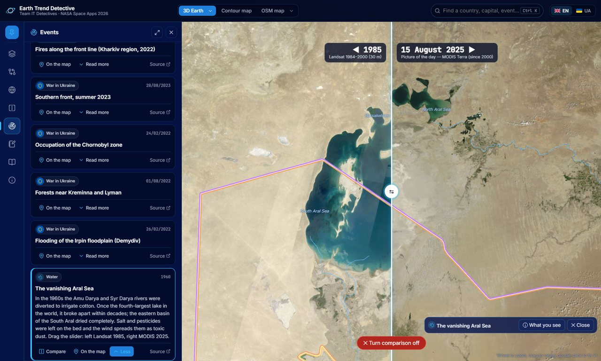
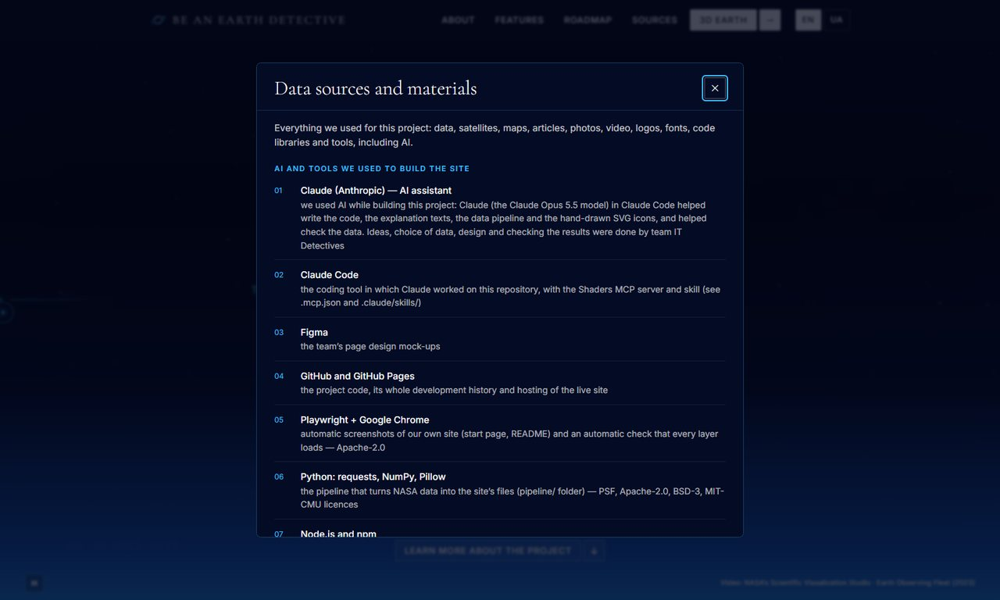

# Earth Trend Detective — IT Detectives

[English](README.md) · **Українська**


**NASA Space Apps Challenge 2026 · [Earth System Trend Detective](https://www.spaceappschallenge.org/2026/challenges/earth-system-trend-detective/)**

### ▶ Сайт: **https://luufus.github.io/Nasa-Space-App-Challenge/**

Інтерактивна Земля для всіх, кому цікаво, як змінюється наша планета: супутникові дані NASA на 3D-глобусі,
контурній карті й карті OpenStreetMap, порівняння країн, перевірка трендів на статистичну значущість і пояснення
простими словами. Англійською та українською, безкоштовно, без реєстрації.

## Скриншоти

| | |
|---|---|
|  |  |
|  |  |
|  |  |
|  |  |

## Що вміє

| | |
|---|---|
| 🌍 **3D Земля** | Тайли NASA GIBS з рівнями деталізації (як у Google Earth), атмосфера, зорі, справжні хмари обраного дня (VIIRS) |
| 🛰 **Карта OSM** | Детальна карта OpenStreetMap (MapLibre GL): класична, світла, темна (векторні тайли OpenFreeMap, підписи UA/EN) або супутникова NASA з підписами. На ній ті самі шари NASA GIBS (у веб-Меркаторі, зі значенням під курсором), лінія фронту, події, пожежі, порівняння країн |
| ⚠️ **Підказки-аномалії** | Коли увімкнено шар (хлорофіл, NDVI, температура, лід, пожежі, NO₂, AOD, SO₂, озон, GRACE, опади, нічні вогні…), на карті з'являються значки там, де він показує щось незвичне — 26 місць. Наведи — відкриється вікно, яке можна гортати: що ти бачиш, чому так (люди чи природа), чим загрожує, приклад із життя, що з цим роблять, супутникове фото того місця й графік змін за роки з трендом (Сен + Манн–Кендалл). Дані готує крок 11 |
| 🌙 **Земля вночі** | Уся планета у світлі міст (Black Marble 2016) — кнопка в шарах «Нічні вогні» і посилання з фото на стартовій сторінці |
| 🌬 **Прогноз погоди (ідея Windy)** | Живий прогноз Open-Meteo на 4 дні на карті OSM: рухомі лінії вітру (частинки), пориви, температура, опади, хмарність, вологість, тиск з ізобарами, грози (CAPE), PM2.5 і пилові бурі (CAMS); шкала часу з анімацією, легенда, прогноз у точці кліку з графіком і назвою місця (Nominatim) |
| 🗺 **Контурна карта** | Глобус «розгортається» в карту світу (проєкція Equal Earth); біла суша, блакитні моря, сітка — як шкільна контурна карта. Для глобальних тем програма *пропонує* перейти на неї, але питає згоди |
| 🧭 **Кордони** | Кожна країна обведена смужкою **свого** кольору з внутрішнього боку кордону — видно, чий кордон; малі країни — пунктиром, мікродержави — кільцем; Крим — у складі України (Natural Earth, Ukraine POV) |
| 🏙 **Підписи** | Країни, столиці, річки, океани й моря українською/англійською, з усуненням накладань |
| 🛰 **Шари** | 39 шарів NASA: температура повітря й поверхні, NDVI/EVI, вологість ґрунту, опади, вологість повітря, сніг, лід, GRACE, пожежі, нічні вогні, NO₂, PM2.5, аерозолі, SO₂, CO, метан, озон… з датою, анімацією, легендою і значенням під курсором |
| 📈 **Порівняння країн** | Дві країни, 15 змінних (зокрема NDVI, температура поверхні, PM2.5, аерозолі, SO₂ з MODIS), сезони, аномалії, різниця A−B. Тренд — **нахил Сена** з 95 % інтервалом + **модифікований тест Манна–Кендалла** (Hamed & Rao 1998, поправка на автокореляцію) + **сезонний тест Манна–Кендалла** (Hirsch 1982); показано Z, критичне значення 1,96 і p; МНК — для порівняння. Прогноз до 2030–2050 уздовж лінії Сена з 95 % інтервалом і перевіркою на минулому (hindcast). Пропуски в даних не заповнюються, а пропускаються й рахуються. Формули з підставленими числами й поясненням «чому саме ці числа» |
| 🆚 **Порівняння країн** (одна вкладка) | Дві країни поруч зі знімками вдень і вночі; зведення «Головні виклики» / «Позитивні тренди» (порівняно з рештою світу, у перцентилях); згорнуте «Детальне дослідження» — усі показники з міні-графіками, і кожен відкриває свій графік, прогноз і формули просто в таблиці |
| 🌡 **Карти трендів** | Наші розрахунки по кожному пікселю (нахил Сена + модифікований Манн–Кендалл): де тренд значущий (p < 0,05); порівняння першого й останнього десятиліття повзунком; річні аномалії температури 1980–2025 з анімацією |
| ⇆ **Було / стало** | Розділений екран з повзунком: Арал (Landsat 1985 → MODIS 2025), Каховка, Урмія, Поопо, Рондонія, Пакистан… |
| 🇺🇦 **Війна в Україні** | Лінія фронту й окуповані території щомісяця з лютого 2022 за **офіційним переліком ТОТ** (наказ Мінрозвитку № 376) на межах громад OCHA, з анімацією та порівнянням дат; графік окупованої площі; події: Каховська ГЕС, блекаути (нічні вогні), пожежі вздовж фронту, Чорнобильська зона, ліси біля Кремінної, Демидів — з поясненням «що ти бачиш»; графік пожеж FIRMS 2001–2025 за областями |
| 🔥 **Поширення пожеж** | Точки NASA FIRMS день за днем (колір = вік вогню), програвання, денна гістограма, рух центру пожежі й напрям (Чорнобильська зона 2020, Австралія 2019–20, Канада 2023, фронт 2022–23) |
| 🌀 **Події 2026** | Пожежі в США, спека в Європі, ураган, озеро Пауелл, повені в Таїланді, землетрус і цунамі — «було / стало» і графіки причин: чим погода перед подією відрізнялася від норми 1991–2020 (NASA POWER) |
| 🏠 **Стартова сторінка** | «Be An Earth Detective»: відео NASA SVS 1080p60 із супутниками на орбітах, на якому під курсором розходяться брижі (WebGPU, пакет `shaders`); про проєкт — проблема, рішення, для кого; можливості зі скриншотами сайту; «як це працює»; фото Землі NASA 1968–2025; фінал із полярним сяйвом; кнопки, що переливаються, і кільце-курсор. Без WebGPU або з «зменшеним рухом» — та сама сторінка без ефектів |
| 🔎 **Пошук, нотатки, плани** | Пошук країни, столиці чи події (Ctrl+K); власні нотатки з посиланнями на шари, дати й місця (зберігаються лише в браузері, можна зберегти у файл); список «Майбутні оновлення» з ШІ-помічником та іншими планами |
| 📖 **Глосарій** | ~50 термінів і формул (NDVI, p-значення, Манн–Кендалл, Добсон…) |
| 🇬🇧/🇺🇦 | Англійська за замовчуванням, українська — одним кліком |

## Запуск на комп’ютері

```bash
npm install
npm run dev        # http://localhost:5173
npm run build      # static site in dist/ (works from any sub-folder, e.g. GitHub Pages)
npm test           # unit tests for the statistics
```

## Публікація на GitHub Pages

```bash
npm run deploy     # збирає dist/ і відправляє його в гілку gh-pages
```

Сайт відкривається за адресою `https://<user>.github.io/<repository>/`. GitHub сам вмикає Pages після першого
`gh-pages`; якщо ні — у **Settings → Pages → Build and deployment** вибери *Deploy from a branch*, гілка `gh-pages`, папка `/ (root)`.

## Дані

Дані вже лежать у `public/data`. Щоб перебудувати їх з першоджерел NASA:

```bash
python -m pip install -r pipeline/requirements.txt
python pipeline/run_all.py            # all steps (first run downloads a few GB of tiles, ~30 min)
python pipeline/run_all.py 02 06      # only some steps
```

Крок 10 (лінія фронту) читає офіційний перелік ТОТ: завантаж додатки до наказу № 376 (.docx, зараз це три файли
редакції від 26.05.2026) з [zakon.rada.gov.ua/laws/show/z0380-25](https://zakon.rada.gov.ua/laws/show/z0380-25) у `pipeline/data/tot/`
і запусти `python pipeline/run_all.py 10`. Громада вважається окупованою, коли окуповано щонайменше половину її населених пунктів зі списку.

Для розробників з Claude Code: у `.mcp.json` підключено MCP-сервер [Shaders](https://shaders.com/docs/guide/mcp)
(при першому підключенні попросить увійти в акаунт Shaders), у `.claude/skills/shaders/` — скіл бібліотеки.

## Стек

React 19 · Vite · Three.js (власний рушій тайлів, без готових глобус-бібліотек) · MapLibre GL (карта OSM) · Shaders (WebGPU-ефекти стартової сторінки) · ECharts · KaTeX · Zustand · Lucide ·
Python (requests, numpy, Pillow) для конвертації даних NASA.

```
src/engine/    3D engine: TileLayer (GIBS quadtree), LineLayer (borders), Labels, Controls, globe↔map morph
src/lib/       statistics (stats.js + tests), explanations, legends (colour → number), dates
src/ui/        panels: layers, compare, country report, planet, before/after, events, fires, causes, glossary, about
src/map/       OpenStreetMap view (MapLibre): base maps, NASA layers in web Mercator, front line, weather (Open-Meteo)
src/landing/   start page (content.js = all texts; shaders.jsx = WebGPU effects)
src/content/   events, glossary, variables (UA/EN texts)
pipeline/      01…10 Python scripts that turn NASA (and other open) data into files in public/data
```

## Використання ШІ

Під час розробки ми використовували ШІ: **Claude (Anthropic)**, модель Claude Opus 5.5 у Claude Code, допомагав писати
код, тексти пояснень, пайплайн даних і намальовані вручну SVG-іконки, а також перевіряти дані. Ідеї, вибір даних,
дизайн і перевірку результатів робила команда IT Detectives.

## Джерела

Усе, що ми використали: дані, супутники, карти, статті, фото, відео, логотипи, шрифти, бібліотеки коду й інструменти.
Той самий список є на сайті (стартова сторінка → **Джерела** і панель **Про проєкт** у застосунку). Його скопійовано
з [`src/content/sources.js`](src/content/sources.js) командою `npm run sources`.

<!-- sources:start -->

### ШІ та інструменти, якими ми робили сайт

- [Claude (Anthropic) — AI assistant](https://www.anthropic.com/claude) — ми використовували ШІ під час розробки: Claude (модель Claude Opus 5.5) у Claude Code допомагав писати код, тексти пояснень, пайплайн даних і намальовані вручну SVG-іконки, а також перевіряти дані. Ідеї, вибір даних, дизайн і перевірку результатів робила команда IT Detectives
- [Claude Code](https://claude.com/claude-code) — інструмент, у якому Claude працював із цим репозиторієм, разом із MCP-сервером і скілом Shaders (див. .mcp.json і .claude/skills/)
- [Figma](https://www.figma.com) — макети дизайну сторінок, які зробила команда
- [GitHub and GitHub Pages](https://github.com/LuuFus/Nasa-Space-App-Challenge) — код проєкту, уся історія розробки й розміщення сайту в інтернеті
- [Playwright + Google Chrome](https://playwright.dev) — автоматичні скриншоти нашого сайту (стартова сторінка, README) і автоматична перевірка, що кожен шар завантажується — Apache-2.0
- [Python: requests, NumPy, Pillow](https://www.python.org) — пайплайн, що перетворює дані NASA на файли сайту (папка pipeline/) — ліцензії PSF, Apache-2.0, BSD-3, MIT-CMU
- [Node.js and npm](https://nodejs.org) — збирання сайту й тести статистики (node --test) — MIT

### Дані й сервіси NASA

- [NASA GIBS (WMTS / WMS)](https://gibs.earthdata.nasa.gov) — усі супутникові знімки й шари даних, офіційні палітри й легенди; частина NASA EOSDIS / Earthdata — суспільне надбання (NASA)
- [NASA Worldview](https://worldview.earthdata.nasa.gov) — посилання «Відкрити в NASA Worldview» для кожного шару
- [NASA Worldview Snapshots](https://wvs.earthdata.nasa.gov) — супутникові фото місць у підказках-аномаліях (Terra, Aqua, Suomi NPP) — суспільне надбання
- [NASA POWER](https://power.larc.nasa.gov) — клімат 246 країн 1981–2025, графіки підказок і щоденна погода для подій 2026 року (NASA Langley Research Center, проєкт POWER) — вільне використання
- [NASA GISS GISTEMP v4](https://data.giss.nasa.gov/gistemp/) — температура планети з 1880 року (GISTEMP Team: GISS Surface Temperature Analysis, NASA GISS)
- [datasets/global-temp](https://github.com/datasets/global-temp) — CSV-копія тих самих чисел GISTEMP; пайплайн бере її, лише коли сервер NASA недоступний — ODC-PDDL
- [NASA Ozone Watch](https://ozonewatch.gsfc.nasa.gov) — площа озонової діри й мінімум озону
- [NASA FIRMS](https://firms.modaps.eosdis.nasa.gov) — пожежі в Україні 2001–2025 і поширення вогню під час подій. Використано дані системи NASA FIRMS (Fire Information for Resource Management System), частини NASA ESDIS
- [NASA DSCOVR EPIC](https://epic.gsfc.nasa.gov) — фото всієї Землі з відстані 1,5 млн км (21.06.2025) — суспільне надбання

### Супутники, прилади й моделі, з яких зроблено шари (усі — через NASA GIBS)

- [Terra & Aqua — MODIS (NASA)](https://www.earthdata.nasa.gov/data/instruments/modis) — знімки дня, хибні кольори 7-2-1, температура поверхні, NDVI / EVI, сніг, типи поверхні (MCD12Q1), хлорофіл в океані, пожежі
- [Suomi NPP, NOAA-20, NOAA-21 — VIIRS (NASA / NOAA)](https://www.earthdata.nasa.gov/data/instruments/viirs) — знімки дня, пожежі (375 м), нічне світіння за конкретну ніч, хлорофіл в океані
- [Black Marble (NASA)](https://blackmarble.gsfc.nasa.gov) — нічні вогні всієї планети (VIIRS)
- [Blue Marble (NASA Earth Observatory)](https://science.nasa.gov/earth/earth-observatory/collections/blue-marble/) — основні знімки Землі (рельєф і справжні кольори)
- [Landsat (NASA / USGS) — WELD](https://science.nasa.gov/mission/landsat/) — мозаїка Landsat 1984–2000 (Web-Enabled Landsat Data) і знімки «було»
- [MERRA-2 (NASA GMAO)](https://gmao.gsfc.nasa.gov/gmao-products/merra-2/) — місячні температура повітря, вода в ґрунті, опади, водяна пара, пил PM2.5, аерозолі, SO₂, озон на 50 гПа
- [GHRSST MUR (NASA JPL PO.DAAC)](https://podaac.jpl.nasa.gov/MEaSUREs-MUR) — температура поверхні моря та її аномалія
- [SMAP (NASA)](https://smap.jpl.nasa.gov) — щоденна вологість ґрунту
- [GPM IMERG (NASA / JAXA)](https://gpm.nasa.gov/data/imerg) — щоденні опади
- [AIRS on Aqua (NASA JPL)](https://airs.jpl.nasa.gov) — вологість повітря й метан
- [AMSR2 on GCOM-W (JAXA)](https://www.eorc.jaxa.jp/AMSR/) — концентрація морського льоду (продукт AMSR Unified)
- [GRACE & GRACE-FO (NASA / DLR / GFZ)](https://grace.jpl.nasa.gov) — запаси води (GRACE Tellus mascons) і підказка про підземні води Індії
- [Aura — OMI (NASA, KNMI, FMI)](https://science.nasa.gov/mission/aura/) — діоксид азоту (NO₂) і загальний озон
- [Suomi NPP — OMPS (NASA / NOAA)](https://ozoneaq.gsfc.nasa.gov) — загальний озон
- [Terra — MOPITT (Canadian Space Agency, University of Toronto, NCAR)](https://www2.acom.ucar.edu/mopitt) — чадний газ (CO)
- [Sentinel-5P — TROPOMI (ESA / EU Copernicus, KNMI)](https://sentiwiki.copernicus.eu/web/s5p-mission) — діоксид азоту (NO₂, шар TROPOMI). Містить змінені дані Copernicus Sentinel, оброблені ESA і KNMI

### Інші наукові дані

- [NOAA GML — Mauna Loa CO₂](https://gml.noaa.gov/ccgg/trends/) — CO₂ в атмосфері (Dr. Xin Lan, NOAA/GML, і Dr. Ralph Keeling, Scripps) — уряд США, суспільне надбання
- [NSIDC Sea Ice Index v4 (G02135)](https://nsidc.org/data/g02135) — площа морського льоду (Fetterer et al., NSIDC) — вільно з посиланням
- [Open-Meteo](https://open-meteo.com) — дані погоди від Open-Meteo.com: прогноз на «Карті OSM» (найкращі моделі національних метеослужб, як-от DWD, NOAA, ECMWF) — CC BY 4.0, некомерційне використання
- [Copernicus Atmosphere Monitoring Service (CAMS)](https://atmosphere.copernicus.eu) — прогноз якості повітря (PM2.5, пил) через Open-Meteo: створено з використанням інформації Copernicus Atmosphere Monitoring Service
- [NOAA NESDIS](https://www.nesdis.noaa.gov/imagery/hurricanes/2026-hurricane-season-media-gallery) — ураган Ісаяс 2026 (посилання)

### Карти, кордони й назви

- [OpenStreetMap](https://www.openstreetmap.org/copyright) — карта світу на «Карті OSM» — © учасники OpenStreetMap, ODbL
- [Nominatim](https://nominatim.org) — назви місць для прогнозу в точці (зворотне геокодування nominatim.openstreetmap.org) — © учасники OpenStreetMap, ODbL
- [OpenFreeMap](https://openfreemap.org) — векторні тайли OpenStreetMap і шрифти карти Noto Sans (світла й темна карта) — безкоштовно, без ключа
- [OpenMapTiles](https://openmaptiles.org) — схема векторних тайлів і стилі Positron / Dark Matter для світлої й темної карти — © OpenMapTiles, дизайн стилів © CARTO; BSD-3 / CC BY 4.0
- [Natural Earth 1:10m (Ukraine POV)](https://www.naturalearthdata.com) — кордони, столиці, річки, озера, моря (файли з github.com/nvkelso/natural-earth-vector) — суспільне надбання
- [OCHA COD-AB Ukraine (HDX)](https://data.humdata.org/dataset/cod-ab-ukr) — межі громад України для шару фронту — CC BY-IGO (з посиланням)
- [Order No. 376 of the Ministry for Development of Communities and Territories of Ukraine](https://zakon.rada.gov.ua/laws/show/z0380-25) — наказ Мінрозвитку № 376: офіційний перелік окупованих територій і територій бойових дій — офіційний документ (не об’єкт авторського права)
- [Equal Earth projection (Šavrič, Patterson, Jenny, 2019)](https://doi.org/10.1080/13658816.2018.1504949) — картографічна проєкція контурної карти — вільне використання

### Статті, факти й методи (лише посилання, тексти написали ми)

- [NASA Earth Observatory / NASA Science](https://science.nasa.gov/earth/earth-observatory/) — статті до подій і підказок-аномалій
- [NASA Climate](https://science.nasa.gov/climate-change/) — історія про рекорд арктичного льоду
- [NOAA and NOAA GLERL](https://www.glerl.noaa.gov) — «мертва зона» Мексиканської затоки й цвітіння озера Ері
- [HELCOM](https://helcom.fi) — цвітіння й мертві зони Балтійського моря
- [IAEA](https://www.iaea.org/newscenter/focus/ukraine) — факти до подій війни (ядерні об’єкти України)
- [EcoZagroza (Ministry of Environmental Protection of Ukraine)](https://ecozagroza.gov.ua) — шкода довкіллю від війни
- [Wikipedia](https://en.wikipedia.org) — дати й цифри деяких подій 2026 року
- [Trend statistics](https://doi.org/10.1016/S0022-1694(97)00125-X) — нахил Сена (Sen, 1968), тест Манна–Кендалла (Mann, 1945; Kendall, 1975), модифікований тест (Hamed & Rao, 1998), сезонний тест (Hirsch et al., 1982) — власний код
- [Windy.com](https://www.windy.com) — натхнення для карти погоди (рухомі лінії вітру, шкала часу) — код і дані не брали

### Фото, відео, іконки, шрифти й логотипи

- [NASA Scientific Visualization Studio](https://svs.gsfc.nasa.gov/5061/) — фонове відео стартової сторінки «Earth Observing Fleet (January 2023)» — супутники NASA на орбітах; оригінал 1920×1080 60 кадрів/с, копія 1280×720 і кадр-обкладинка; суспільне надбання
- [NASA Image and Video Library](https://images.nasa.gov) — фото «Схід Землі» (Apollo 8, 1968), «Блакитна куля» (Apollo 17, 1972), «Чорна куля» (Suomi NPP, 2016) — суспільне надбання
- **Screenshots of this site** — картинки можливостей на стартовій сторінці й у README — скриншоти нашого власного сайту
- [Lucide icons](https://lucide.dev) — іконки інтерфейсу й маркерів подій — ISC; іконки стартової сторінки й знак проєкту (планета з орбітою) намальовані для цього проєкту (SVG-код)
- [Fonts: Cormorant Garamond, Inter, JetBrains Mono (Fontsource), Noto Sans](https://fontsource.org) — SIL Open Font License 1.1
- [NASA Space Apps Challenge logo](https://www.spaceappschallenge.org) — показано, щоб назвати хакатон; належить NASA Space Apps
- [Noosphere Engineering School logo](https://noosphereglobal.com/) — логотип нашого партнера, наданий командою; належить власнику

### Бібліотеки з відкритим кодом

- [React 19](https://react.dev) — інтерфейс — MIT
- [Vite 8 and @vitejs/plugin-react](https://vite.dev) — сервер розробки й збирання — MIT
- [Three.js](https://threejs.org) — 3D-глобус (наш власний рушій тайлів поверх неї) — MIT
- [MapLibre GL JS](https://maplibre.org) — «Карта OSM» (плоска й глобус) — BSD-3-Clause
- [Apache ECharts](https://echarts.apache.org) — графіки — Apache-2.0
- [KaTeX](https://katex.org) — формули — MIT
- [Zustand](https://github.com/pmndrs/zustand) — стан застосунку — MIT
- [Lucide / lucide-react](https://lucide.dev) — компоненти іконок — ISC
- [Shaders](https://shaders.com) — WebGPU-ефекти стартової сторінки (брижі під курсором, полярне сяйво) — MIT

### Хакатон

- [NASA Space Apps Challenge 2026 — “Earth System Trend Detective”](https://www.spaceappschallenge.org/2026/challenges/earth-system-trend-detective/) — челендж, на який відповідає проєкт; зробила команда IT Detectives
<!-- sources:end -->

Обмеження чесно описані у вкладці «Про проєкт»: значення країни — середнє з кількох точок POWER;
карти трендів і NDVI країн отримані з кольорів GIBS (точність = крок палітри); прогноз — продовження лінійного тренду.

## Команда

IT Detectives · NASA Space Apps Challenge 2026
